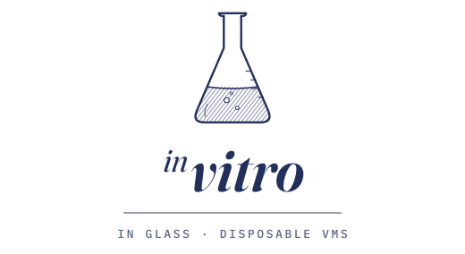

<p align="center">
  <picture>
    <source media="(prefers-color-scheme: dark)" srcset="docs/images/vitro-header-dark.svg">
    
  </picture>
</p>

<p align="center">
  <strong>Disposable development VMs driven from a CLI.</strong>
</p>

_In vitro_ — in glass — is work done outside the living organism, precisely so
the organism is not put at risk. That is what this is for: the machine you ruin
is not the one you work on.

```console
$ vitro run windows           # a copy-on-write overlay on a golden image
windows-7f3a2c is up: ssh dev@127.0.0.1 -p 53422
$ vitro exec windows-7f3a2c cargo test
$ echo $?                     # the guest's exit code, not vitro's
101
$ vitro destroy windows-7f3a2c
```

Or all of it at once — start a fresh VM, send it this project, run the tests,
and throw the VM away:

```console
$ vitro run --rm --sync . windows -- cargo test
```

## What it is for

Answering "does this actually work on that operating system?" when you do not
have that operating system to hand.

It exists because answering that used to mean buying a second machine, paying
for a hypervisor licence that unlocks its CLI, or asking somebody to click
through an installer. The work that produced vitro had all three of those in
front of it and took none of them.

Three things it has been used for, in earnest:

- **Settling a question that only Windows can answer.** An investigation had
  been stuck for weeks because nothing could drive a Windows guest without a
  human at its screen.
- **Doing things to a machine you would not do to yours.** Enabling developer
  mode, installing several gigabytes of build tools, registering packages,
  rewriting ACLs under `Program Files`. None of it touches the host, and
  `destroy` ends it.
- **Building software the host cannot build.** A Windows ARM64 binary, compiled
  and run and looked at, from a Mac.

`exec` returning the guest's own exit code is what makes the VM a build target
rather than somewhere to poke around by hand: `vitro exec win cargo test` fails
here exactly when it fails there.

**If a Linux guest is all you need, use something else.** Docker, Lima and
multipass are faster, lighter and far better worn. vitro earns its place on
Windows and macOS guests, which is where the gap was.

## Try it

Two things to install — vitro itself, and QEMU, which brings the guest firmware
with it. With Homebrew, on macOS or Linux, one command does both and adds the
shell completions:

```console
$ brew install lambdalisue/vitro/vitro
```

With Nix, the flake installs vitro with its shell completions; QEMU comes from
wherever you get it. Main's builds are kept in the `vitro` Cachix cache, which
the flake offers on first use — accept it, or run `cachix use vitro` once, and
this is a download rather than a Rust build:

```console
$ nix profile install github:lambdalisue/vitro
```

Or from crates.io, with QEMU installed separately:

```console
$ cargo install vitro
$ brew install qemu                        # macOS
$ sudo apt install qemu-system qemu-utils  # Debian, Ubuntu
```

`vitro completions <shell>` prints a completion script for a shell the
packages above did not set up.

Then let vitro do the rest:

```console
$ vitro setup
```

It makes the SSH key, asks which guest you want first, works out where the
guest firmware is if this host's machine needs one, offers to let `scp` and
`rsync` reach VMs by name, and writes a configuration for that host:

```
  key       ~/.config/vitro/id_ed25519 (created)
  config    ~/.config/vitro/config.toml is missing
            which guest first? [Windows/linux/macos/skip]
```

### A Windows guest

Answering Windows — the default — gets you the one instruction vitro cannot
carry out for you:

```
Windows needs an installer ISO, and Microsoft does not allow anyone to
redistribute it — so this is the one part vitro cannot do for you.

  1. Open  https://www.microsoft.com/software-download/windows11arm64
  2. Choose "Windows 11 (multi-edition ISO for Arm-based PCs)", pick a language, and download
  3. Save it into  ~/.local/share/vitro/media

The filename does not matter: vitro identifies the media by the volume label
inside it. That label also says which architecture the ISO is for, and this
host needs aarch64 — the wrong one does not fail, it stalls at the installer's
first screen, so vitro checks before starting anything.
```

That page and that edition name are the ones for an Apple Silicon host, which
is what everything below was run on. **A guest always matches the host's
architecture**, so on x86-64 vitro names Microsoft's ordinary Windows 11
download and the x64 edition instead, and there is no `firmware` setting to
fill in — that machine boots from QEMU's own BIOS. Nothing else differs.

That directory is created for you, so the download can go straight there — and
because vitro looks in it, the whole configuration is this:

```toml
[images.windows]

[images.windows.build]
kind          = "unattended-install"
disk_size     = "80G"
build_timeout = "90m"
```

No `source`, and no `golden` either: with `golden` unset, `run` starts whatever
`build` last made for the image, so there is nothing to edit between the two.

```console
$ vitro build windows
An unattended Windows install needs the virtio drivers, which Windows does not ship.
Download them from https://fedorapeople.org/…/stable-virtio/virtio-win.iso? [y/N] y
built …/golden/windows-20260920-165554.qcow2 in 16m
the guest account's password is q5vsqqfvAmxetuytKbWT-7
```

Sixteen minutes, and nobody touched the installer. From then on a fresh Windows
machine is seconds away:

```console
$ vitro run windows
windows-7f3a2c is up: ssh dev@127.0.0.1 -p 53422
$ vitro exec windows-7f3a2c cargo test
$ vitro destroy windows-7f3a2c
```

macOS guests work the same way through
[`lume`](https://github.com/trycua/cua), with no file to download at all.
[docs/guests.md](docs/guests.md) has both in full.

### Checking the plumbing first

Before spending sixteen minutes on an install, it is worth knowing that QEMU,
the firmware, the key and the networking are all in order. Answering `linux` at
the guest prompt writes a cloud-image configuration instead — **not because
Linux is what vitro is for**, but because it is the one guest that needs nothing
downloaded by hand, so it answers that question in seconds rather than minutes:

```console
$ vitro build linux
built …/golden/linux-20260920-160437.qcow2 in 16s
$ vitro run linux && vitro exec linux-7f3a2c uname -a
```

`vitro` with no arguments prints what is running and what to do next,
including any VM that has been up for over a day and is due to be promoted or
destroyed. When
something will not start, `vitro doctor` checks every prerequisite and prints a
`→` line with the exact fix.

## The model

```
build    installation media ──(once, minutes)──> golden image
run      golden image ──(copy-on-write overlay, seconds)──> VM
destroy  the overlay goes; the golden image is untouched
```

A VM is only disposable if getting another one back is cheap, which is why
those are two commands rather than one. `run --rm <image> -- <command>` puts
the cheap half to work: it starts a VM, runs the command, exits with the
command's exit code, and destroys the VM whether the command passed, failed or
was interrupted. Without a command, `run --rm` opens a shell and destroys the
VM when the shell closes. `promote` runs the other way: it turns
a VM you have set up into a new golden image, so the hour spent installing a
toolchain is spent once.

## Commands

| Command                  | What it does                                         |
| ------------------------ | ---------------------------------------------------- |
| `setup`                  | Get from nothing to a guest you can build            |
| `build <image>`          | Build a golden image from installation media         |
| `run <image> [-- <cmd>…]` | Start a VM, and run a command in it (`--rm`, `--sync`, `--cpus`, `--memory`) |
| `exec [<vm>] <cmd>…`     | Run a command in a VM and pass its exit code through |
| `ssh [<vm>]`             | Open an interactive shell                            |
| `cp <src>… <dest>`       | Copy files between the host and a VM (`<vm>:<path>`) |
| `test [<image>…]`        | Run the project's `vitro.toml` command on each image |
| `destroy <vm>` / `--all` | Stop a VM and delete its overlay                     |
| `promote <vm>`           | Turn a running VM into a new golden image            |
| `ls`                     | List VMs and golden images (`--json`, `--prune`)     |
| `status [<vm>]`          | What is running, and what to do next (`--json`)      |
| `keygen`                 | Create the SSH key vitro authorises guests with      |
| `doctor`                 | Check everything `run` and `build` depend on         |
| `completions <shell>`    | Print a completion script (bash, zsh, fish, …)       |
| `ssh-config [<vm>]`      | Print an `ssh_config` block (`--write`)              |
| `forward <vm> <port>…`   | Forward guest ports to the host                      |
| `port [<vm>]`            | Print the SSH port and nothing else                  |
| `inspect [<vm>]`         | Print the VM's record as JSON                        |
| `screenshot [<vm>]`      | Save a picture of the guest's screen                 |
| `key <vm> <chord>…`      | Press keys on the guest's keyboard (`shift-a`)       |
| `click <vm> <x> <y>`     | Click at a pixel of the guest's screen               |
| `launch [<vm>] <cmd>…`   | Start a program on the guest's desktop               |

A VM can be named by its full name, by the image it was started from, or by
any unambiguous prefix — `vitro exec windows cargo test` reaches the one
Windows VM. A name that fits several lists the candidates rather than picking
for you. Where the table shows `[<vm>]`, the VM can be left out while only one
is running.

Exit codes are `0` success, `1` failure, `2` a bad command line — except
`exec` and `run … -- <cmd>`, which return whatever the guest's command
returned.

`exec --cwd <dir>` runs the command in a guest directory and `--env NAME=VALUE`
sets a variable for it. vitro writes both in the guest shell's own syntax, so
the same line works against a Windows guest, whose shell is PowerShell:

```console
$ vitro exec --cwd project --env RUST_BACKTRACE=1 windows cargo test
```

`exec --sync <dir>` copies a host directory into the guest first and runs the
command inside it. Only what `.gitignore` keeps is sent, so `target/` and
`.git` stay behind:

```console
$ vitro exec --sync . windows cargo test
```

Anything that needs a pipeline, a loop or more than a line belongs in a script
rather than on the command line. `exec --script` copies it in, runs it with the
arguments that follow, and removes it; a Windows guest runs `.ps1` files with
no execution policy in the way:

```console
$ vitro exec --script ./collect-logs.ps1 windows -Since 1h
```

On a Windows guest every `exec` sees `PATH` as it stands now, so a tool
installed earlier in the session is found without restarting the guest.

## Testing a project

A project can say once how it is tested, in a `vitro.toml` at its root:

```toml
images  = ["windows", "macos"]
command = ["cargo", "test"]

[env]
RUST_BACKTRACE = "1"
```

`vitro test`, run anywhere inside the project, then gives each image a fresh
VM, copies the project in, runs the command and destroys the VM, and ends with
a verdict per image:

```console
$ vitro test
windows  passed
macos    failed (exit code 101)
$ vitro test windows -- --nocapture    # one image, with extra arguments
```

[docs/spec/project-file.md](docs/spec/project-file.md) lists every key.

## Driving it from Claude Code

This repository is also a Claude Code plugin marketplace. Its plugin carries a
skill that teaches an agent to use vitro the way it is meant to be used — the
one-shot `run --rm`, destroying what it started, PowerShell on Windows guests:

```console
/plugin install vitro --marketplace lambdalisue/vitro
```

On a Claude Code older than 2.1.275, add the marketplace first:
`/plugin marketplace add lambdalisue/vitro`, then `/plugin install vitro@vitro`.

## Reaching a guest from other tools

Copying is built in. A guest path is written `<vm>:<path>`, or `:<path>` while
only one VM is running, and directories are copied whole:

```console
$ vitro cp ./src Cargo.toml windows:project
$ vitro cp :project/target/release/app.exe .
```

The forwarded SSH port changes on every `run`, which is fine for `vitro exec`
and `vitro cp` and useless for `rsync`, a debugger or an editor's remote
connection.

```console
$ vitro ssh-config --write
wrote ~/.config/vitro/ssh_config
```

Add `Include ~/.config/vitro/ssh_config` near the top of `~/.ssh/config` once,
and every VM is reachable as `vitro-<name>` with no port number anywhere:

```console
$ scp ./payload vitro-linux-7f3a2c:
$ rsync -a ./src/ vitro-linux-7f3a2c:src/
```

## Documentation

| | |
| --- | --- |
| [docs/guests.md](docs/guests.md) | What each guest needs, and where to get it |
| [docs/configuration.md](docs/configuration.md) | Every setting, and what it changes |
| [docs/internals.md](docs/internals.md) | How a build and a run actually work |
| [docs/troubleshooting.md](docs/troubleshooting.md) | Things that look like failures and are not |

## What has actually been run

Worth being exact about, because the interesting bugs in this kind of tool are
the ones no test suite sees.

| Host                | State                                                              |
| ------------------- | ------------------------------------------------------------------ |
| macOS, aarch64      | **Exercised end to end.** Linux, Windows and macOS guests, built, run, promoted and destroyed |
| Windows             | Builds, lints and passes its tests. **No VM has ever been started** |
| Linux               | CI runs the same checks. **No VM has ever been started**           |

The Windows unattended install is verified on an aarch64 host. The x86-64 path
is written and reachable and has never been run. See
[docs/internals.md](docs/internals.md) for what that means in practice.

## Development

```console
$ nix develop
$ just ci         # fmt, clippy, tests — what CI runs
```

CI runs those checks on Linux, macOS and Windows. Linux matters most: it is the
host this is least often developed on, and the one where a portability mistake
would otherwise go unnoticed until somebody tried it.

Releasing starts from a GitHub release:

```console
$ just release-check          # what crates.io will refuse, found locally
```

Then write the notes and publish a release tagged `vX.Y.Z` on GitHub. The tag
is the only record of the version — `Cargo.toml` holds `0.0.0` and the workflow
stamps the tag into it. From there it builds a binary on a native runner for
each of the six supported targets, attaches them to the release with their
checksums, and publishes to crates.io once every target has built — because
that is the one step that cannot be undone. It authenticates with crates.io
through trusted publishing, so there is no registry token in the repository's
secrets.

## License

MIT. See [LICENSE](LICENSE).
